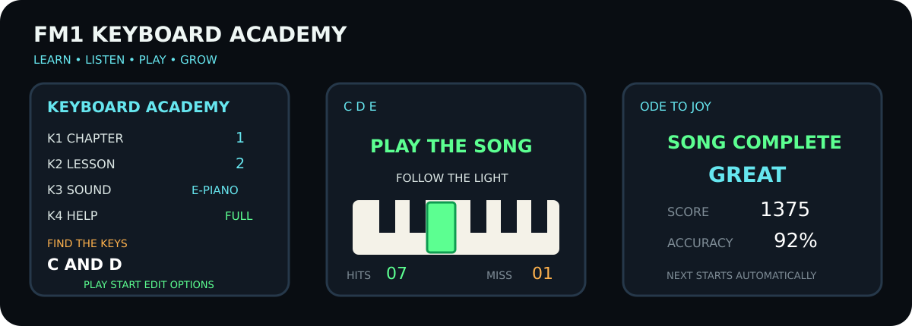
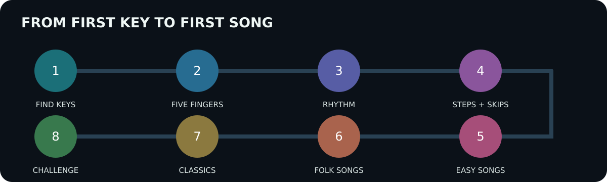

# FM1 Keyboard Academy

Beginner-first learning firmware for the M-VAVE FM-1. It boots directly into
a small keyboard course, demonstrates each exercise, lights the relevant keys,
listens to the learner and adapts the next attempt. The full FM synthesizer,
standard DX7 presets, 32 algorithms, sequencer and project import remain
available behind the simple learning home screen.

> Community firmware, not an M-VAVE product. Back up projects, voices and
> samples before installing. There is no known easy hardware recovery path.

## What is included

- 8 progressive chapters, starting with finding middle C;
- 12 purpose-built foundation exercises;
- 30 short public-domain/traditional melodies;
- listen → watch → play → review loop;
- optional demonstration and next-key lights;
- red display feedback after a wrong note;
- automatic replay after inactivity;
- automatic repeat below 80% and progression at 80% or better;
- score, accuracy and friendly mastery rating;
- direct control from the four upper knobs;
- selectable standard sounds, with the original DX7 algorithm editor retained;
- editable/importable 4,064-byte FM1 Open projects.

## Four-knob learning home

| Control | Main screen | Options screen |
|---|---|---|
| K1 | Chapter | Demo lights |
| K2 | Lesson | Player lights |
| K3 | Sound preset | Metronome |
| K4 | Help level | Automatic next lesson |

`PLAY` starts or retries, `REC` repeats the demonstration, `EDIT` opens the
four learning options and `HOME` returns from an exercise. From the home screen,
`HOME` opens the full instrument; pressing it again returns to the academy.

## Course map

1. Find the Keys — black-key groups, middle C, C–D–E.
2. Five Fingers — one relaxed five-note position.
3. Rhythm — steady pulse, long/short notes and rests.
4. Steps and Skips — direction changes, seconds and thirds.
5. Easy Songs — first complete melodies.
6. Folk Songs — longer phrases and musical memory.
7. Classics — wider ranges and faster patterns.
8. Challenge — play complete melodies with less assistance.

Every lesson is first demonstrated. During the learner's turn a wrong note does
not advance the course; the display flashes red and waits for the correct key.
After ten seconds without input, the demonstration starts again automatically.

## Firmware download and safety

The latest release asset is `FM1_KEYBOARD_ACADEMY_V04.fwsc`. Verify it before use:

~~~sh
sha256sum FM1_KEYBOARD_ACADEMY_V04.fwsc
python3 verify_fwsc.py FM1_KEYBOARD_ACADEMY_V04.fwsc --expect FM-1_8241004
~~~

The release keeps the verified stock-V15 16 KiB startup region byte-for-byte,
uses the original 1 MiB flash layout and retains the 536,576-byte user region.
V04 SHA-256: `c65d04439f57011d43483d336c501472a3e38ac51ebed327093225b5b30bff7c`.
Only install on an FM-1 you are prepared to recover if an unofficial update
fails. Keep power and USB connected for the entire two-stage update.

## MIDI melody import

~~~sh
node tools/import-midi.mjs melody.mid template.fm1project output.fm1project
~~~

Options: `--track 1-8`, `--midi-track 1-N`, and `--grid 1|2|4|8`. Import changes
the destination pattern, tempo, name and loop length while retaining its sound,
preset and DX7 algorithm.

## Build and test

On ARM64 Linux/Raspberry Pi, provide JieLi's x86-64 PI32v2 toolchain and a
private amd64 runtime, then run:

~~~sh
bash tests/run.sh
FM1_STOCK_PACKAGE=/path/to/verified/FM-1_V15.fwsc \
  python3 tools/build-linux-qemu.py
~~~

The build runs the official compiler through QEMU, validates the SDK manifest,
links the real target ELF, checks required symbols and packages an update while
preserving the stock startup region. Details are in [BUILDING.md](docs/BUILDING.md)
and the curriculum rationale is in [COURSE.md](docs/COURSE.md).

## Project status

V04 is a public preview. Host tests and the complete PI32v2 build pass, and the
package has been installed successfully on a physical FM-1. The complete course
still needs extended play-through testing across every lesson and sound.

## License

Application changes are GPLv3 with the FM1 SDK linking exception. The included
binary SDK and firmware resources retain their separate terms. See
[LICENSE.md](LICENSE.md) and [THIRD_PARTY.md](THIRD_PARTY.md).

---

## Development history and upstream FM1 Open reference

The material below documents the earlier FM1 Learn prototype and the FM1 Open
base on which Keyboard Academy is built.

Show historical and upstream documentation

## FM1 Learn V01

FM1 Learn is a modified FM1 Open firmware for guided keyboard practice. It
keeps the complete FM1 Open synthesizer, preset browser, DX7 algorithm editor,
sequencer and project transfer format, and adds:

- a 30-song public-domain practice library;
- a guided step mode with illuminated next key, note display and scoring;
- learning from any melodic track edited with the existing on-device step or
  live-recording tools;
- Standard MIDI File import that preserves the template project's timbre,
  preset and DX7 algorithm.

This project is based on M-VAVE FM1 Open V14 and was modified on 2026-10-24.
It is not an official M-VAVE release. Back up projects, DX7 voices and samples
before installing any development build.

To stay inside the unchanged official Flash layout, FM1 Learn replaces the 16
read-only factory demo projects with the first 16 lessons. The sound-preset
library, DX7 algorithms, editable user-project slots and user/sample storage
remain available. The dedicated lesson browser contains all 30 melodies.

## Using the learning mode

Open the sequence action menu with **SEQ + EDIT** (or hold **SEQ**) and choose
one of these actions:

- **LEARN THIS TRACK** practises the melodic notes already on the selected
  track. Empty steps are skipped. The expected key lights up; a wrong note is
  counted but does not advance the lesson.
- **LESSON LIBRARY** opens the 30 built-in melodies. Turn **SELECT** or
  **PRESETS**, press **SAVE**, and the selected melody replaces only the
  selected track. Its preset, sound parameters and FM algorithm are retained.

During a lesson, **REC** resets the score, **SEQ** opens the normal song editor,
and **HOME** returns to the instrument. Loading a built-in melody is undoable
with the existing project undo command.

## Importing a MIDI melody

Export or otherwise obtain a 4,064-byte FM1 Open project to use as a sound
template, then run:

~~~sh
node tools/import-midi.mjs melody.mid template.fm1project output.fm1project
~~~

Optional flags are `--track 1-8`, `--midi-track 1-N`, and `--grid 1|2|4|8`.
The importer supports PPQN Standard MIDI Files type 0 and 1. It selects the
track with the most notes by default, rejects polyphonic collisions and songs
longer than the FM1's 64-step loop, and changes only the destination sequence,
tempo, project name and loop length. All timbre bytes remain intact.

Run the portable tests with `sh tests/run.sh`.

## Upstream FM1 Open V14

English · [简体中文](README.zh-CN.md)

8 tracks, 8 sample slots, 16 FX demos; binary SDK included.

[Workbench and development kit](https://open.m-vave.com/fm1-workbench) · [Official forum](https://forum.m-vave.com)

Use the workbench to update firmware, preview the instrument and manage projects, samples and DX7 voices. Select "Source + SDK" to download the development kit matching the online release. Back up projects, voices and samples before updating, and keep the device powered during writes.

## V14 features

- **DX7 library:** 128 voices in four groups of 32, with the M-VAVE FM1 original V15 factory voices and order. Saved user banks take priority. DX7 single-voice and 32-voice bank SysEx import/export is supported; extension parameters are not handled. Changing the library does not change patches already saved in projects.
- **Track roles:** on SEQ **8/8 TRACK ROLE**, K1 selects NORMAL, PLAY or OFF; K2 selects input MIDI channel 1–16. PLAY retains the track's timbre and held notes across project changes. MUTE/SOLO use the existing controls, with independent NORMAL and PLAY solo groups. PLAY timbre edits are not saved with projects: export a timbre file, or save DX7 voices to the independent library.
- **Step recording:** with the track set to NORMAL, press REC while stopped and play notes. Releasing all played keys advances to the next step, including DRUM 808 and SAMPLER. Overlapping notes share a step; during playback, REC records in time. PLAY tracks are for live performance and do not record notes.
- **Tempo and delay:** internal tempo is 30–300 BPM. Tap Tempo is available on the workbench, with SEQ on the FX DELAY page, or with HOME held while tapping SEQ elsewhere. Delay supports tempo synchronization and fixed times of about 30–2040 ms.

## MIDI

FM1 accepts DIN, USB and BLE MIDI input, with USB/BLE output. Default input channels 1–7 address tracks 1–7; channel 10 addresses track 8. Change each input channel on TRACK ROLE.

- **5/8 SYNC / LOOP:** select internal or external clock, tempo, loop length and clock input.
- **6/8 MIDI TRACK:** select SEQ/ARP LOCAL, BOTH or MIDI output, output channel, output ports and physical KEY OUT.
- **7/8 MIDI ROUTING:** configure LOCAL, CLK OUT and MIDI Thru. For DAW monitoring with Local Off, enable KEY OUT and select the output ports.

MIDI preferences are saved independently of projects. The browser simulator previews these settings without sending performance MIDI to external ports; configure the instrument on its panel. MIDI Clock, Start, Continue, Stop and Song Position Pointer input are supported. Clock loss stops synchronized playback.

## Updates and compatibility

V13 can update to V14. The workbench supports returning to original V15 and migrating from compatible third-party firmware. The standard FM1 update protocol remains available. Compatibility has been checked with selected firmware versions; it is not a guarantee for every third-party release.

Firmware switching does not make project and sample formats interchangeable. Keep exported backups for rollback. Older firmware may not support V14 track preferences, the independent voice library or synchronized/extended delay settings.

To back up the independent voice library, read and export groups A–D separately. Project files do not contain sample audio. Restore custom samples from their sample bank backup; writing the built-in sample bank replaces the current samples.

The eight sample slots share about 19.55 seconds of new sample storage. Existing larger banks remain readable; they may need to be backed up and reduced before writing the independent DX7 library.

## Build

### Raspberry Pi / ARM64 Linux

This tree can be built on the Raspberry Pi without Windows. The local build
runner executes JieLi's official x86-64 Linux PI32v2 toolchain through QEMU:

~~~sh
python3 tools/build-linux-qemu.py
~~~

It expects the JieLi toolchain at
`.toolchain/extracted/jieli-linux-toolchains-20260730.1` and a private extracted
amd64 runtime at `.toolchain/x86-root`; both paths can instead be supplied with
`JIELI_TOOLCHAIN` and `FM1_X86_ROOT`. Set `FM1_STOCK_PACKAGE` to a verified
original V15 `FM-1.fwsc`; its first 16 KiB are retained byte-for-byte so the
custom package does not replace the bootloader/config area. The generated file is
`build/linux-dx7/generated/FM1_LEARN_V01.fwsc`. Set `FM1_BUILD_VERBOSE=1` for
individual compiler commands.

### Windows x64

Requires Windows x64, PowerShell, `curl.exe` and `tar.exe`. Firmware builds require **JieLi Windows toolchain 2.5.3**, which includes PI32v2 clang 4.0.1. [Download the 2.5.3 installer from JieLi](https://jl-update.oss-cn-shenzhen.aliyuncs.com/2.5.3.exe) and follow the [installation guide](https://doc.zh-jieli.com/Tools/zh-cn/dev_tools/dev_env/jl_toolchain.html). Set `FM1_PI32_TOOLCHAIN` to its `pi32` folder containing `bin/clang.exe` (normally `C:\JL\pi32`). FM1 continues to use the `r3` CPU target.

The build checks all 22 toolchain files against `sdk/manifest.json`. Older V14 kits were pinned to 2.5.2 and reject 2.5.3; update the complete source + SDK kit together, keeping the manifest checks enabled. For this revision, the expected SHA-256 of `pi32/bin/clang.exe` is `d4bc97cf421c1ccc373dd8924ce88720ff7457b3f1478d15df4aeda6ae923bce`.

For a local web preview:

~~~powershell
.\tools\Build-Web.ps1 -LocalPreview
~~~

For distribution builds, first set `FM1_SOURCE_URL` to the HTTPS URL of the matching source archive, including your changes, licenses and build/install scripts. Then run:

~~~powershell
.\build.bat --web
$env:FM1_PI32_TOOLCHAIN = 'C:\JL\pi32'
.\build.bat --package
~~~

For a local firmware build without a distribution source URL, run `./sdk/Build.ps1 -FirmwareOnly -Toolchain 'C:\JL\pi32'`. A moving GitHub `tree/main` page is not a matching source archive for distribution.

The web version builds from the included C sources. Its first build downloads WASI SDK 27; set `FM1_WASI_SDK` to reuse an installation. Outputs are `build/preview/index.html`, `build/dx7/generated/FM1_OFFICIAL_OPEN.fwsc` and `build/official-web/FM1-Official-Open-Source.html`.

The [per-track tuning API](app/instrument.h) supports custom tuning; a dedicated tuning editor is not included.

## License

APP: [GPLv3 with the FM1 SDK linking exception](LICENSE.md). The device engine is supplied as a binary SDK with separate terms. Retain the applicable [SDK terms, third-party licenses and contributor notices](THIRD_PARTY.md) when distributing builds.

